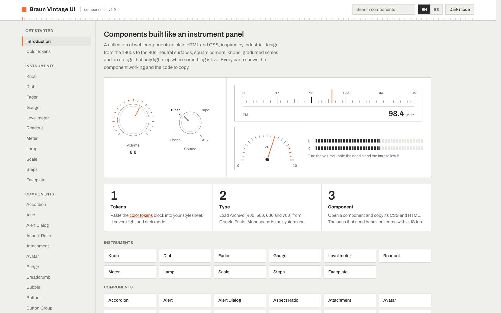
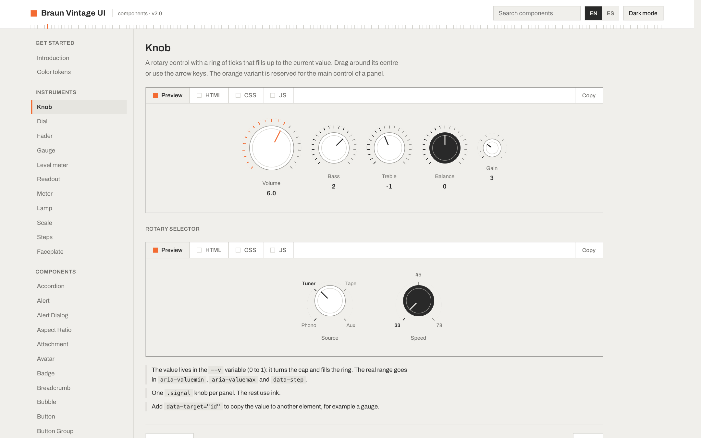
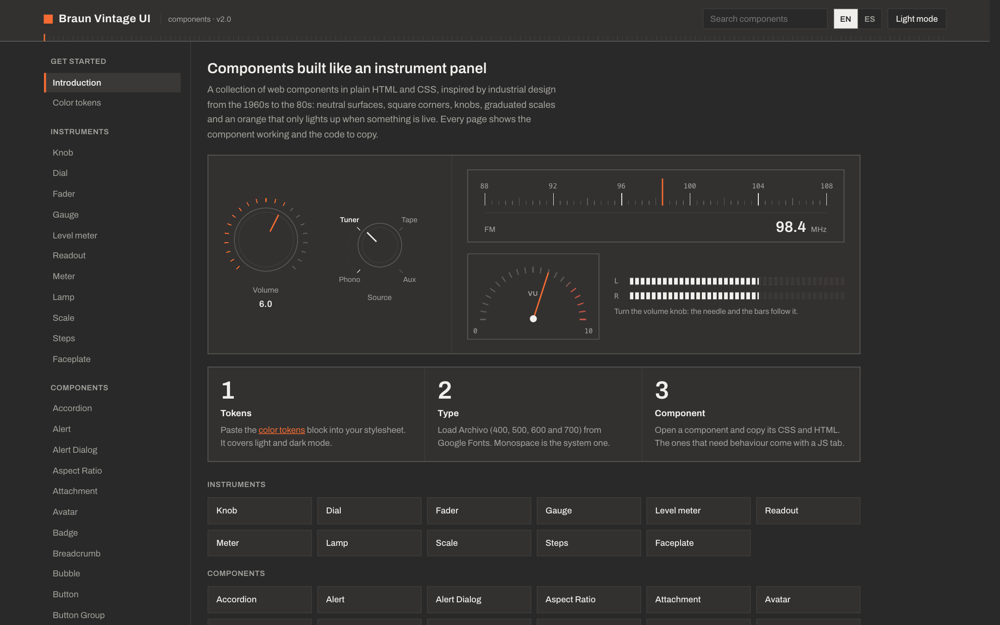
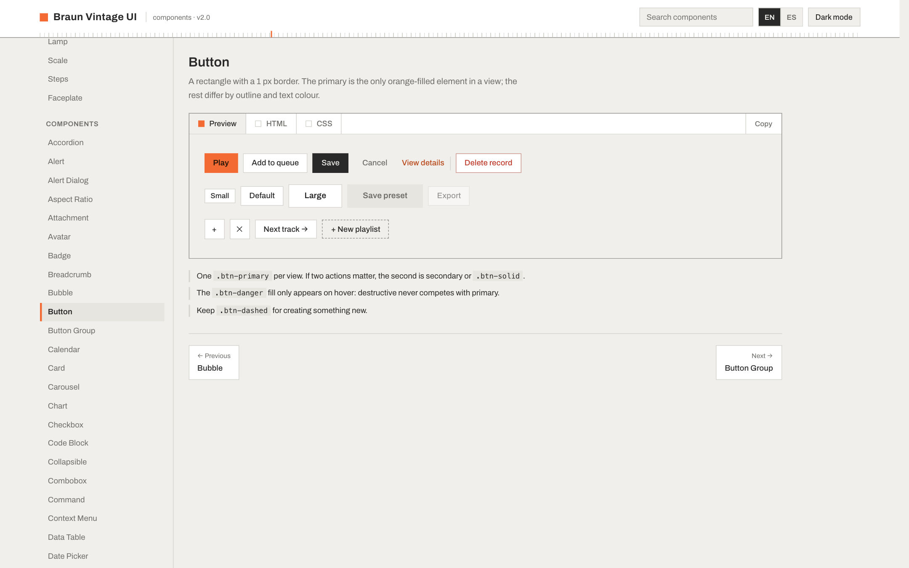
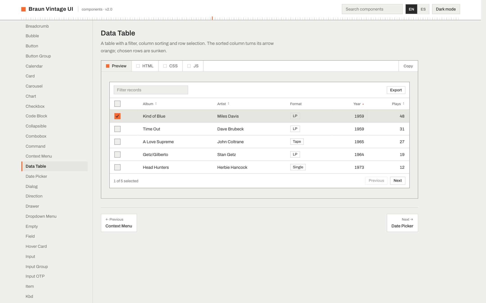
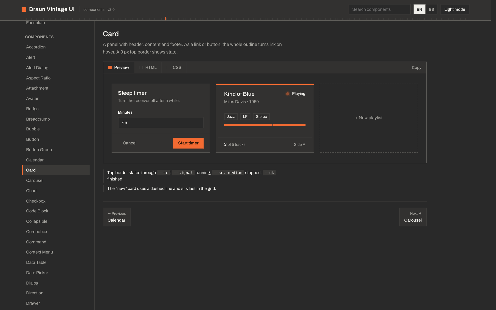

<div align="center">

# Braun Vintage UI

**Web components built like an instrument panel.**

Plain HTML and CSS, inspired by the industrial design of Braun in the 1960s–80s (Dieter Rams, Dieter Lubs):
neutral surfaces, square corners, knobs, graduated scales, and an orange that only lights up when something is live.

[](https://god4n.github.io/braun-vintage-ui/)
[](#use-it-with-claude)
[](#theming)
[](#documentation)

**[→ Open the live gallery](https://god4n.github.io/braun-vintage-ui/)**

<a href="https://god4n.github.io/braun-vintage-ui/"></a>

</div>

---

## What is this?

A design system with three parts:

| | |
|---|---|
| **[Component gallery](https://god4n.github.io/braun-vintage-ui/)** (`braun-ui/`) | A single-file site with every component running live, plus the HTML / CSS / JS to copy. |
| **Style guide** (`BRAUN_VINTAGE_DESIGN.md`) | Principles, palette, typography, spacing and the spec of each component. Also in Spanish. |
| **Claude skill** (`.claude/skills/braun-vintage-design`) | The same system packaged as a skill, so Claude builds new UI in this style. |

The gallery covers **all 66 shadcn/ui components** re-drawn in this language, plus **11 instruments of its own**:
`knob`, `dial`, `fader`, `gauge`, `level`, `readout`, `meter`, `lamp`, `scale`, `steps` and `faceplate`.

## Screenshots

### Instruments

Every continuous value is read against a row of ticks (drawn with repeating gradients, no images) and set with a knob where it fits.



### Dark mode

Same tokens, different values. Switch with the toggle in the header.



### Components

<table>
<tr>
<td width="50%"></td>
<td width="50%"></td>
</tr>
<tr>
<td align="center"><sub>Buttons — one orange primary per view</sub></td>
<td align="center"><sub>Data table</sub></td>
</tr>
</table>



## Design principles

Rams's ten principles, turned into concrete rules for the screen:

- **As little design as possible.** No decorative gradients, no shadows on static elements, no illustrations. Every line separates something.
- **Honest.** A control looks like a control: 1 px border, visible state. Nothing fakes depth it does not have.
- **Understandable.** Short labels, large tabular numbers, units in grey.
- **Unobtrusive.** About 95% of the screen is neutral. Colour only communicates state.
- **Long-lasting.** Orthogonal geometry, square corners, one type family.

> **Orange is a pilot light.** `--signal` means live, active or the main action. Never decoration. As a rule: one orange primary element per view.

## Use it

Visit **[god4n.github.io/braun-vintage-ui](https://god4n.github.io/braun-vintage-ui/)**, pick a component from the sidebar and copy its HTML, CSS and JS from the tabs. Start with *Color tokens* (they cover light and dark) and load [Archivo](https://fonts.google.com/specimen/Archivo) (400, 500, 600, 700).

```css
:root {
  --paper: #F0EFEB;  --panel: #FFFFFF;  --inset: #E6E5E0;
  --line:  #D5D4CF;  --rule:  #92918D;
  --ink:   #292929;  --steel: #92918D;
  --signal: #F36B32; --ok: #46857A;
}
```

## Use it with Claude

The repo ships a **Claude skill**, [`braun-vintage-design`](.claude/skills/braun-vintage-design), that teaches Claude this design system: tokens, typography, the 25 original components and the instruments. With it, Claude Code builds new pages, components and charts in the Braun style on its own.

Copy `.claude/skills/braun-vintage-design` into your project's `.claude/skills/` (or into `~/.claude/skills/` to use it everywhere). Then ask for any UI in a Braun / Dieter Rams / instrument-panel style and Claude loads it automatically.

## Theming

Light and dark share the same token names. The gallery opens in light mode; use the toggle in the header to switch. In your own pages, dark follows `prefers-color-scheme` or can be forced with `data-theme`:

```html
<html data-theme="dark">
```

## Documentation

- [`BRAUN_VINTAGE_DESIGN.md`](BRAUN_VINTAGE_DESIGN.md): full style guide in English
- [`BRAUN_VINTAGE_DESIGN_es.md`](BRAUN_VINTAGE_DESIGN_es.md): guía de estilo completa en español
- The gallery itself is bilingual: use the **EN / ES** switch in the header.

## Repository layout

```
.
├── braun-ui/
│   ├── index.html        # generated single-file gallery
│   ├── build.sh          # joins src/*.html into index.html
│   └── src/              # one file per group of components
├── docs/img/             # README screenshots
├── .claude/skills/       # braun-vintage-design skill for Claude
├── BRAUN_VINTAGE_DESIGN.md
└── BRAUN_VINTAGE_DESIGN_es.md
```

## Credits

Visual language after the work of Dieter Rams and Dieter Lubs at Braun. This is an independent homage and is not affiliated with Braun.
